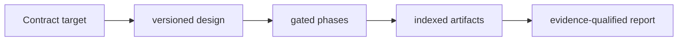

# Contract Analysis Runtime

**Resumable smart-contract security campaigns with explicit evidence states.**

  [](LICENSE)

[Overview](#overview) · [Quickstart](#quickstart) · [Example](#example) · [Validation](#validation) · [Documentation](#documentation)

## Overview

A contract-first runtime for repeatable, resumable security campaigns with explicit evidence states.

**Stack:** Python · JSON manifests · YAML designs · optional Slither/Foundry adapters · MCP interface

## Every phase has an evidence boundary

| Component | Behavior |
| --- | --- |
| Design | Versioned campaign designs specify phases, inputs, outputs and gates. |
| Execution state | Run manifests and artifact indexes support inspection and resumption. |
| Evidence status | Static candidates, compilation and runtime reproduction are distinct states. |

## Processing path



## Quickstart

```console
python -m venv .venv
# Activate .venv, then:
python -m pip install -e .
python -m unittest discover -s tests/design_runtime -p test_models.py -v
```

The commands above install prerequisites or run the specified offline checks. Live collection, cloud operations, messaging and trading are separate operational steps when present.

## Example

**Inspect the workflow**

Read a campaign design before executing adapters. Follow the target through source resolution, gated phases and indexed artifacts. A report should identify the strongest evidence actually produced; static suspicion alone is not reproduced exploitability. The focused model suite exercises offline runtime contracts.

## Configuration and storage

Python 3.11+ is required. JSON manifests retain target/run/artifact state; YAML designs define phases. Slither, Foundry and MCP integrations have separate runtime prerequisites.

## Repository guide

| Location | Responsibility |
| --- | --- |
| [src/vassago_contract_runtime/cli.py](src/vassago_contract_runtime/cli.py) | CLI boundary |
| [src/vassago_contract_runtime/contracts/source_resolver.py](src/vassago_contract_runtime/contracts/source_resolver.py) | Source resolution |
| [designs](designs) | Campaign designs |
| [tests/design_runtime/test_models.py](tests/design_runtime/test_models.py) | Focused contract tests |

## Validation

All six model tests passed on Python 3.13.16 using offline fixtures. Compiler, fork and campaign integrations were not exercised.

## Scope and operational boundaries

The last recorded check passed six offline model tests on Python 3.13.16. It did not provision a compiler, run a fork or conduct a deployed-contract campaign. Private run outputs are not bundled.

## Documentation

- [Architecture](ARCHITECTURE.md)
- [Design decisions](DECISIONS.md)

## License and attribution

Project-authored source code is licensed under the [MIT License](LICENSE). Third-party components and datasets retain their respective rights and licenses.
