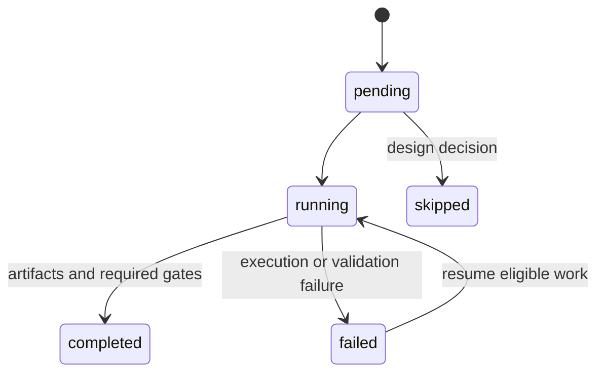

# Contract Analysis Runtime

  [](LICENSE)

Run contract-security investigations as explicit campaigns, with resumable phases and evidence states that survive process boundaries.

This runtime organizes source acquisition, compiler/static-analysis adapters, fork-oriented checks and final artifacts. It does not equate a static suspicion with a reproduced exploit.

## Evidence is part of the data model

[models.py](src/vassago_contract_runtime/design_runtime/models.py) distinguishes phase progress from evidence strength:

| Phase status | Example evidence states |
| --- | --- |
| `pending`, `running`, `completed`, `failed`, `skipped` | `static_only`, `compile_only_passed`, `not_reproduced`, `reproduced_runtime`, `human_review_required` |

A completed phase can therefore produce a limited or blocked result. Target IDs are derived from normalized chain/address identity; artifact and gate definitions are validated before a design runs.



## Read a campaign from the outside in

Start with [designs](designs), then follow the [runner](src/vassago_contract_runtime/design_runtime/runner.py), [manifest](src/vassago_contract_runtime/design_runtime/manifest.py) and [source resolver](src/vassago_contract_runtime/contracts/source_resolver.py). Adapters for Slither, Foundry, explorers and MCP sit behind these runtime contracts.

```console
python -m venv .venv
python -m pip install -e .
python -m unittest discover -s tests/design_runtime -p test_models.py -v
```

Python 3.11+ is declared by the package. The focused model suite is offline and previously passed six tests. It does not install a Solidity compiler, contact a chain or start a fork.

## Taking the runtime further

[ARCHITECTURE.md](ARCHITECTURE.md) and [DECISIONS.md](DECISIONS.md) explain the design. Compiler versions, source availability, RPC access and adapter prerequisites must be configured for the chosen campaign. Private run artifacts are not included, and historical corpus support is not a claim that every referenced scenario was reproduced by this checkout.

**Technology:** Python · JSON manifests · YAML designs · optional Slither/Foundry adapters · MCP interface

Project-authored source: [MIT](LICENSE). Third-party components retain their own notices and terms.
